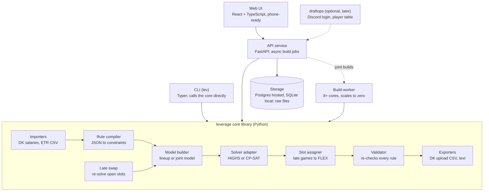

# Leverage Project Spec

This is the canonical design spec. It started as the "Stack Lab Project Spec" Claude Doc (Oct 30,
2026; Stack Lab was the working name) and moved here on Nov 1, 2026. Change it through PRs like
any other file. Why non-obvious choices were made lives in [`DECISIONS.md`](DECISIONS.md).

## Overview

Leverage is a DraftKings NFL Classic lineup optimizer for one serious player building 1 cash lineup
and a small GPP portfolio (6–20 entries) each week. It turns the rules we applied by hand on the
Week 7 main slate into a tested engine: QB stacks, conditional group rules, portfolio exposure
targets, and late swap.

The browser prototype published on Oct 25 (the Stack Lab artifact) proved the model and UI ideas.
This spec replaces it with a structured project: a typed core library, a solver layer, an API, a
web client, and a test suite built from real slates.

**Goals for v1**

- Build valid DraftKings Classic lineups from any projections CSV in under 2 seconds each.
- Express every rule used on Week 7 declaratively, saved per slate and reusable week to week.
- Optimize a portfolio jointly, hitting exposure targets with overlap limits, not one lineup at a time.
- Re-optimize open slots after games lock (late swap) using the salary they free.
- Export the DraftKings bulk-upload CSV and a readable text version.

**Non-goals for v1**

- Contest simulation, field generation and ROI estimates. ETR's tools do this better; revisit later.
- Generating projections. Leverage consumes them (ETR, or any CSV with salary and projection).
- Other sites (FanDuel), other sports, and Showdown. The design keeps roster rules data-driven so
  these can follow.
- Multi-user accounts, payments, or automated lineup submission to DraftKings.

## Requirements from the Week 7 session

Every requirement below comes from something we did by hand on Oct 25 that took a rebuild, a
re-run, or a mistake to get right. Tests that cover one name its ID.

| ID  | What happened on Week 7 | Requirement |
| --- | --- | --- |
| R1  | Six Love lineups came out of an uncapped run | Per-player and global max exposure, as a % of portfolio size |
| R2  | Kittle silently drifted to 0 of 6 GPP lineups; Gibbs to 0 | Min exposure per player, plus a warning when a top-owned player is at 0% |
| R3  | "Higgins or Chase in 2+" was filled with Higgins twice | Group rules count "any of" by default; per-player minimums express "one of each" |
| R4  | Stroud skinny stack also held Marks and the Texans D | Per-QB stack overrides, plus conditional rules: if Stroud, 0 of Marks / Texans D |
| R5  | "Max 1 Bucs pass catcher unless the QB is Young" | Conditional rules with "if none of" triggers |
| R6  | Puka hedge: if Puka, 0 of Mumpfield / Whittington / Atwell | Conditional rules with "if any of" triggers |
| R7  | LaPorta + Kraft repeated as TE/FLEX in two lineups | Pair limits: a set of players may appear together in at most N lineups |
| R8  | Chase paired with the Bengals D | Negative correlation rule: a player and his own DST |
| R9  | Savion added as a one-off, not part of a stack | "Only in stacks" flag: player allowed only when his QB is in the lineup |
| R10 | G4 had two Bucs bring-backs; you allowed it once | Rule exceptions scoped to N lineups in the portfolio |
| R11 | Puka in FLEX so Kyren could replace him | Slot assignment puts the latest-kicking eligible player in FLEX |
| R12 | Puka-out swap needed multiple players, not a straight swap | Late swap re-optimizes every unlocked slot with freed salary |
| R13 | ETR docked Puka to 19, bumped Higbee to 10.8 | Projection overrides per player, saved with the slate |
| R14 | Joint rebuild of G3–G6 beat one-at-a-time swaps by ~4 points | Joint portfolio optimization mode |
| R15 | Ceiling review found one real upgrade | Objective blends projection and ceiling; report both per lineup |
| R16 | Six versions of the lineups printed in chat | Lineup history: every build saved, diffable, with "what changed" |

## Domain model

A Slate holds immutable source data; everything you change (overrides, rules, builds) hangs off a
Workspace so the original projections are never edited in place.

| Entity | Key fields | Notes |
| --- | --- | --- |
| Site / RosterFormat | slots, eligibility per slot, salary cap | DraftKings Classic = QB, RB×2, WR×3, TE, FLEX (RB/WR/TE), DST; $50,000. Data, not code |
| Slate | id, site, format, week, games, created from which files | One per contest slate (e.g. 2026 W7 Main) |
| Game | id, away team, home team, kickoff (UTC) | Drives late swap and FLEX placement |
| Player | dk_id, name, position(s), team, opponent, game, salary | From the DK salary file; dk_id is the stable key |
| Projection | player, source (ETR), proj, floor, ceiling, ownership by field size, imported_at | Several sources per slate allowed; one is active |
| Workspace | slate, active projection source, settings | Your working copy for a slate |
| PlayerOverride | player, proj, lock, ban, min/max exposure, only-in-stack, source, status | R1, R2, R9, R13 |
| Rule | type, params, enabled, allowViolations (0 = holds in every lineup), source, status | See Rule system |
| Build | workspace snapshot hash, mode (sequential / joint), seed, solver, duration | One optimizer run |
| Lineup | build, slots[9] → player, salary, proj, ceiling, ownership, tags | Pinned lineups survive rebuilds |
| Portfolio | name, contest type (cash / GPP), lineups, target size | Week 7 had Cash ×1 and GPP ×6 |
| SwapRun | portfolio, locked games, results per lineup | Late swap proposals before you apply them |

A Build stores a hash of the exact inputs (projections, overrides, rules, settings), so any lineup
can be traced back to why it was built. Overrides and rules carry a source (you, or an agent
proposal with its citation) and a status (proposed / approved); only approved items reach a build.
This is the hook for the v2 research agent.

## Architecture

One Python core library holds all domain and optimizer logic; the CLI, API and web UI are thin
layers over it, and draftops can mount it later without the core importing anything from draftops.



A build flows through importers, rule compiler, model builder and solver, then back through slot
assignment, validation and export; late swap re-enters at the model builder with locked slots.

**Repo layout**

```
src/leverage/
  cli.py        # Typer app, entry point `lev`
  domain/       # Slate, Player, Game, Lineup, Portfolio (pydantic)
  rules/        # schema + compiler, one module per rule type
  model/        # lineup and joint portfolio model builders
  solvers/      # HiGHS and CP-SAT behind a Solver protocol
  swap/         # late swap
  io/           # DK salary + entries files, projection mapper, DK upload export
  validate.py   # independent checker
  api/          # FastAPI app, job runner, persistence (M3)
web/            # React + TypeScript (Vite), TanStack Query (M3)
fixtures/       # golden slates: 2026-w07-main/
docs/
```

**Stack.** Python 3.12, pydantic v2, highspy, OR-Tools, pandas, FastAPI, Postgres when hosted (v1
is hosted) and SQLite for local dev and tests; React + TypeScript for the UI; uv for dependencies;
pytest + Hypothesis; GitHub Actions CI; Docker image for deployment.

## Optimizer engine

Each lineup is a 0/1 integer program: one binary variable per player, maximize the score, subject
to roster, salary and rule constraints. This is the same model used for every Week 7 build, and it
solved in 0.1–0.6 s per lineup on a 273-player slate.

**Objective.** For player i with projection p, ceiling c and ownership o:

```
maximize  Σ xᵢ · [(1 − w)·pᵢ + w·cᵢ] · (1 + εᵢ)  −  λ · Σ xᵢ·oᵢ
```

- w = ceiling weight (0 for cash, 0–0.5 for GPP).
- λ = ownership penalty in points per 1% owned. 0.1 traded about 4 projected points (155.1 to
  150.8) for about 58 points less total ownership on Week 7.
- ε = optional per-lineup random noise for variety, seeded so builds are reproducible.

**Core constraints**

- Exactly 9 players; salary between the minimum used and $50,000.
- Position counts from the RosterFormat: 1 QB, 2–3 RB, 3–4 WR, 1–2 TE, 1 DST, and RB+WR+TE = 7.
- Locks = 1, bans = 0.
- No offensive player facing your DST: for each DST d, the count of opposing offense ≤ 9 × (1 − x_d).
- Max players per team (offense).

**Stack constraints** (per QB q, linearized with big-M on the QB's variable):

- pass catchers from q's team ≥ minPass × x_q, and ≤ maxPass when q is used.
- bring-back players from q's opponent ≥ bbMin × x_q, and ≤ bbMax.

**Slot assignment** happens after solving: the latest-kicking eligible RB/WR/TE takes FLEX (R11),
so late swap has the most room.

**Solver choice.** Model building is solver-agnostic behind a small interface. Use HiGHS for single
lineups, sequential mode and late swap: it is fast on one core and deterministic when
single-threaded. Use OR-Tools CP-SAT for joint portfolio builds: conditional rules and
allowViolations scopes map to its native enforcement literals (no big-M), and its parallel search
suits the all-boolean joint model. CP-SAT needs integer coefficients, so projections are scaled
×100. CP-SAT's speed comes from about 8 parallel workers, so joint builds run on a separate build
worker with 8+ dedicated cores that scales to zero between builds; the web server stays small. Its
parallel search is not deterministic unless interleaved mode is on, so turn that on only if
reproducibility proves to matter. This split is provisional until the M0 solver benchmark
(Portfolio optimization) confirms it. The prototype's in-browser solver (YALPS) stays only for an
offline or demo mode.

## Rule system

Rules are data: a typed, versioned JSON document per workspace that the engine compiles into
constraints. You write them in the UI or by hand; the same file drives the CLI, the API and tests.

| Rule type | Parameters | Week 7 example |
| --- | --- | --- |
| stack_default | minPass, maxPass, bbMin, bbMax, positions | QB + 1 pass catcher, 1 bring-back |
| stack_qb | qb, same params | Stroud: exactly 1 pass catcher, 0 bring-back |
| group | when (always / ifAny / ifNone), triggers, targets, op, n | If Puka, 0 of Mumpfield, Whittington, Atwell |
| team_group | team, positions, op, n, unless_qb | Max 1 TB WR/TE unless QB is Young |
| exposure | player, min %, max % | Chase ≥ 1 lineup, Kittle 2 of 6 |
| pair_limit | players, max lineups together | LaPorta + Kraft together in ≤ 1 lineup |
| avoid_own_dst | player or team | No Chase with the Bengals D |
| only_in_stack | player | Savion only alongside Love |
| game_presence | games, min lineups | GB@DET in 5 of 6 lineups |
| dst_pool | allowed DSTs, min per DST | At least 1 Vikings lineup |
| salary | min used, max | Min $49,000 |
| uniqueness | min unique players vs any lineup | 3 |

**Scope.** Every rule holds in every lineup by default. A rule may set allowViolations: N, meaning
it may be broken in at most N lineups of the portfolio (R10: two Bucs bring-backs allowed once).
This compiles to an indicator variable per lineup in joint mode.

**Example document**

```json
{
  "version": 1,
  "stack_default": {"minPass": 1, "bbMin": 1},
  "rules": [
    {"type": "stack_qb", "qb": "dk:44556892", "minPass": 1, "maxPass": 1, "bbMax": 0},
    {"type": "group", "when": "ifAny", "triggers": ["dk:44556892"],
     "targets": ["dk:44556984", "dk:44557803"], "op": "atMost", "n": 0,
     "label": "Stroud: no Marks or Texans D"},
    {"type": "team_group", "team": "TB", "positions": ["WR", "TE"], "op": "atMost",
     "n": 1, "unless_qb": ["dk:44556890"], "allowViolations": 1}
  ]
}
```

Rules reference players by DraftKings ID, so they survive name changes like "Chris Godwin Jr.". The
UI shows names.

**Diagnostics.** When a build is infeasible, the engine finds a minimal set of conflicting rules
with a deletion filter (drop each rule in turn and leave it out only if the build stays infeasible
without it), then names that set ("Kittle min 50% and pair_limit Kittle+CMC can't both hold").

## Portfolio optimization

The engine supports two build modes; joint is the planned default for GPP portfolios of 20 or fewer
lineups, pending the solver benchmark below.

| Mode | How it works | Strengths | Weaknesses | Week 7 evidence |
| --- | --- | --- | --- | --- |
| Sequential | Solve lineup k with lineups 1..k−1 fixed: exposure caps count what's built, uniqueness bans repeats | Fast (≤ 1 s per lineup), scales to 150 | Greedy: early lineups take the best players, later ones get leftovers; min exposure is hard to hit | 6 lineups in 0.6 s; Kittle drifted to 0 |
| Joint | One model with N × players variables; exposure, pair limits and overlap are constraints across lineups | Hits exposure targets exactly; best total score | Model grows with N² overlap terms; up to a few minutes for 4 lineups in the Week 7 prototype (PuLP + CBC) | +4 total points over one-at-a-time swaps, every target met |

**Joint model additions**

- Exposure: for each player, min ≤ Σ over lineups x ≤ max (counts, from % × N).
- Overlap: for each lineup pair, shared players ≤ 9 − minUnique, using a product variable per
  player (as on Week 7) or, cheaper, a symmetry-breaking order plus pairwise cuts added lazily.
- Fixed lineups: pinned lineups enter as constants, so you can rebuild G3–G6 around a fixed G1–G2.
- Objective: sum of lineup scores; optional diversity bonus to avoid near-duplicate stacks.

**Performance target.** These targets are unverified: Week 7's only data point is a few minutes for
4 lineups on PuLP + CBC. The first M0 task is a benchmark of the Week 7 joint model at 6 and 20
lineups, on HiGHS and CP-SAT, at 1, 2 and 8 cores; it sets the default mode, the solver split and
the build worker size. Targets: joint mode for 6 lineups under 30 s, 20 lineups under 3 min, with
a time limit that returns the best solution found and its optimality gap. Above 20 lineups, fall
back to sequential with exposure "debt" carried forward.

**Cash vs GPP.** A portfolio has a contest type. Cash defaults to w = 0, λ = 0, one lineup, no stack
requirement. GPP defaults to the Week 7 settings: λ = 0.1, QB + 1, minUnique 3.

## Late swap

Late swap re-solves only the unlocked slots of each lineup, with the salary those players free up,
and shows proposals before anything changes.

1. Choose locked games: by kickoff ("everything through 1:00 PM") or individually. Kickoffs come
   from the DK salary file.
2. Update the pool: ban inactives, edit projections (e.g. Puka out → Kyren and Rams TEs up).
3. Re-solve per lineup. The model assigns players to specific open slots (slot-level variables),
   since a locked player's slot can't move. A small bonus keeps current players in place, so you
   only see swaps that gain points.
4. Review a diff per lineup (old → new, Δ proj, Δ salary), apply all or one by one. Applied swaps
   export as DK's edited entries file, ready for DK's late-swap upload.

**Rules during late swap.** Exposure, group and pair rules re-apply across the portfolio. Stack
rules re-apply only if the QB's game is still open; if the QB is locked, his stack minimum is
checked against the locked pieces and not enforced on the rest.

**Planned swaps.** You can store a contingency before lock, like "if Puka is out: Puka → Gibbs and
LaPorta → Parkinson". At swap time the engine checks it is still valid and the best option, and
offers it first.

**Portfolio-aware option.** Late swap can run jointly over all open slots in all lineups, so a
Puka-out pivot doesn't push every lineup to the same replacement.

## Data ingestion and export

The DK salary file is the source of truth for players; projection files attach to it by DraftKings
ID, falling back to name + team.

| Input / output | Format | Handling |
| --- | --- | --- |
| DK salary file (DKSalaries.csv) | Name, ID, Position, Roster Position, Salary, Game Info, TeamAbbrev | Creates players and games; parses kickoff from Game Info (ET → UTC) |
| ETR projections | Player, DK Pos, Team, Opp, DK Salary, DK Proj, DK Value, Small Field, Large Field, DK Floor, DK Ceiling, id | Column mapper with saved presets; ownership column chosen per portfolio (small vs large field) |
| Other projection CSVs | Any headers | Same mapper; required: name, position, team, salary, projection |
| Projection overrides | JSON or UI | Stored separately; re-applied after a re-import |
| DK bulk upload | QB,RB,RB,WR,WR,WR,TE,FLEX,DST with DK IDs | Validated against the salary file before export |
| Text export | One line per lineup, slot → name | For chat, notes and manual entry in the DK UI |
| Late swap edit file | DK's entries export, edited | v1: import DK's entries export (with Entry IDs), export the edited file for upload |

**Matching and validation.** Names are normalized (suffixes, punctuation, "D/ST" → DST). Unmatched
rows are reported, never dropped silently. Re-importing a newer ETR file (they update Saturday and
Sunday morning) keeps overrides and rules, and reports which players' projections moved by more
than 1 point.

**Storage.** Raw files are kept as uploaded, with a hash, so any build can be reproduced exactly.

**ETR data.** Uploading your own ETR projections to your hosted instance is personal use, as with
any optimizer. ETR data is never made public: it is never committed to this repo (see Testing).

## API and interfaces

Three front doors share one core library: a CLI first (fastest to test with real slates), then an
HTTP API, then the web UI on top of the API.

**CLI**

```
lev slate import --salaries DKSalaries.csv --projections etr_w7.csv
lev build --slate 2026-w7-main --rules rules.json --portfolio gpp --n 6 --mode joint
lev exposure --portfolio gpp
lev swap --portfolio gpp --lock-through 13:00 --ban "Puka Nacua"
lev export --portfolio gpp --format dk-upload > upload.csv
```

**HTTP API** (REST + JSON; builds are async jobs)

| Method | Path | Purpose |
| --- | --- | --- |
| POST | /slates | Upload salary + projection files |
| GET | /slates/{id}/players | Pool with projections and overrides |
| PATCH | /workspaces/{id}/overrides | Locks, bans, projection edits, exposure |
| PUT | /workspaces/{id}/rules | Replace the rule document (validated) |
| POST | /workspaces/{id}/builds | Start a build; returns a job id |
| GET | /builds/{id} | Status, lineups, diagnostics |
| GET | /portfolios/{id}/exposure | Exposure vs field ownership |
| POST | /portfolios/{id}/swaps | Propose late swaps |
| POST | /swaps/{id}/apply | Apply some or all proposals |
| GET | /portfolios/{id}/export?format=dk | Upload CSV |

**Web UI** (the prototype's five tabs, carried over): Players (pool, lock/ban, projection edits,
exposure targets), Rules (stack defaults, per-QB presets, group rules in sentence form), Lineups
(cards, exposure vs field chart, pin, diff between builds), Late swap (lock by kickoff, proposals,
apply), Data (imports, column mapping). Must work on a phone, since Sunday-morning edits happen there.

## Testing and validation

Every lineup the engine returns is re-checked by an independent validator before it's shown or
exported. On Week 7, each mistake we caught was a rule silently not applied, so the validator
matters more than solver tests.

- **Validator.** A separate, plain-code checker (no solver) for slot eligibility, salary, roster
  counts, DST conflicts, every rule in the document, exposure and overlap. It runs on every build in
  production and in tests.
- **Golden slates.** The Week 7 main slate (273 players) is fixture #1, with expected results: the
  pure max-projection lineup is 155.1 points at $50,000; the first stacked build with λ = 0.1 is
  147.9. Add one slate per week as fixtures. Committed fixtures pair the real DK salary file with
  synthetic projections, so ETR data never reaches the repo. The real ETR files stay local
  (gitignored), and tests that reproduce the 155.1 and 147.9 results run only when those files are
  present.
- **Property tests** (Hypothesis): random pools and random rule sets either produce a valid lineup
  or a diagnosis that names conflicting rules, never a silently invalid lineup.
- **Solver parity.** On models both solvers prove optimal, HiGHS and CP-SAT give the same objective
  value (within 0.01 points after CP-SAT's ×100 scaling). Time-limited runs are excluded, since a
  stopped search returns whatever it found.
- **Rule compiler tests.** Each rule type gets a minimal pool where the rule is the only thing
  deciding the answer.
- **Late swap tests.** Locked players never move; freed salary is used; a Puka-out case reproduces
  the Week 7 plan.
- **Performance budget in CI.** Sequential ≤ 1 s per lineup and joint 6-lineup ≤ 30 s on the Week 7
  fixture; CI fails if it regresses by more than 50%.
- **Frontend.** Playwright tests at desktop and 390 px phone width: import, build, late swap, export.

## Milestones and roadmap

v1 is four phases, and each ends with a pass/fail test on the Week 7 slate rather than a date. The
CLI is usable after M1, so you can run real slates from week two.

| Phase | Scope | Closed when |
| --- | --- | --- |
| M0 Foundations | Solver benchmark, CI; domain model, DK + ETR importers; independent validator; Week 7 golden fixture | Max-projection lineup = 155.1 on Week 7 |
| M1 Engine + CLI | Lineup model on HiGHS; stack + group rules; sequential portfolios; DK upload export | Week 7 portfolio rebuilt from rules.json |
| M2 Portfolio + swap | Joint model on CP-SAT; pair and scope rules; late swap + DK entries; infeasibility report | 6 joint lineups in 30 s; Puka-out swap works |
| M3 API + web UI | FastAPI, build jobs; React UI, five tabs; phone layout; deploy + build worker | v1: a full Sunday run from a phone |

After v1: the research agent (v2, below), then contest sims; mount into draftops if that becomes
the direction.

## v2: research agent

The v2 agent turns what you read and hear each week into proposed changes to data the engine
already uses. It never builds or enters lineups itself.

- **Inputs:** articles (PDF or web), podcast transcripts or audio, injury and news updates.
- **Outputs:** proposed projection bumps, rule sets and exposure targets, each with a citation
  (document and page, or episode and timestamp) and a one-line reason.
- **Approval:** proposals land in the workspace with status proposed; you approve or reject each
  before a build uses it. The validator still checks every lineup.
- **Build:** Python, on the Claude API, with the player pool, rule document and optimizer exposed
  to the agent as tools.

v1 prepares for this with the source and status fields on overrides and rules.

## Open questions and risks

**Open questions**

- [ ] Standalone repo, or a module inside draftops? Recommendation: standalone core library first,
      mount into draftops later if it becomes your fantasy-tools hub and already has auth and a
      player table.
- [ ] Typical GPP portfolio size going forward: 6 (as on Week 7) or up to 20? This decides whether
      joint mode is the default.

**Decided** (reasoning in [`DECISIONS.md`](DECISIONS.md))

- [x] Language: Python for the engine, API and agent layer; TypeScript + React for the web client.
- [x] Hosting: v1 is hosted so it works from a phone on Sunday mornings.
- [x] ETR terms: personal upload to your own instance is fine; ETR data is never made public.
- [x] Name: Leverage (CLI and short form: `lev`).

**Risks**

| Risk | Impact | Mitigation |
| --- | --- | --- |
| Joint mode too slow at 20 lineups | Sunday-morning rebuilds take minutes | Time limit + best solution so far; CP-SAT on the build worker; sequential fallback |
| A rule compiles wrong and nothing notices | Invalid or off-plan lineups entered | Independent validator on every build; golden slates |
| ETR or DK change CSV columns | Imports break on a Sunday | Column mapper presets, clear errors, fixture per week |
| Scope creep into sims | v1 never ships | Sims come after v2; v1 ends at export + late swap |
| Joining draftops too early | Coupled codebases, slower changes to both | Core library has no draftops imports; integrate through the API |
