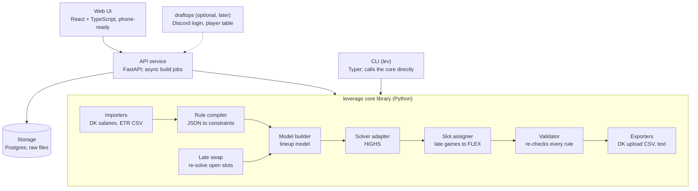

# Leverage Project Spec

This is the canonical design spec. It started as the "Stack Lab Project Spec" Claude Doc (Oct 30,
2026; Stack Lab was the working name) and moved here on Nov 1, 2026. Change it through PRs like
any other file. Why non-obvious choices were made lives in [`DECISIONS.md`](DECISIONS.md).

## Overview

Leverage is a DraftKings NFL Classic lineup optimizer for one serious player entering 1 cash lineup
and 6–20 GPP entries each week. It turns rules that are usually applied by hand into a tested
engine: QB stacks, conditional group rules, exposure targets, and late swap. It is not DFS on
autopilot: the engine generates and checks lineups, and the owner chooses what gets played.

The browser prototype (the Stack Lab artifact) proved the model and UI ideas.
This spec replaces it with a structured project: a typed core library, a solver layer, an API, a
web client, and a test suite built from real slates.

**Goals for v1**

- Build valid DraftKings Classic lineups from any projections CSV in under 2 seconds each.
- Express every rule in the Rule system declaratively, saved with the slate's build configs.
- Build batches of any size (30 is normal) with exposure and overlap limits across the batch, save
  lineups to groups, and choose entries by hand.
- Re-optimize open slots after games lock (late swap) using the salary they free.
- Export the DraftKings bulk-upload CSV and a readable text version.

**Non-goals for v1**

- Contest simulation, field generation and ROI estimates. ETR's tools do this better; revisit later.
- Generating projections. Leverage consumes them (ETR, or any CSV with salary and projection).
- Other sites (FanDuel), other sports, and Showdown. The design keeps roster rules data-driven so
  these can follow.
- Multi-user accounts, payments, or automated lineup submission to DraftKings.
- Automatic selection of final entries, and joint portfolio optimization (R14; see Builds and
  groups).

## Principles

1. **Describe, generate, choose.** You describe what makes a lineup acceptable, the engine
   generates lineups, and you choose from them.
2. **Rules are general.** No rule describes one specific lineup. To see a particular build, set a
   rule or lock a player and look at what comes back.
3. **You can always override.** Any player can be forced in, whatever a build produced.
4. **Limits shape builds; views inform choices.** Limits apply during a build. Saved lineups are
   never blocked, only shown with their exposure and any problems.

## Requirements

Each requirement comes from something that took a rebuild, a re-run or a mistake to get right when
building lineups by hand. Tests that cover one name its ID.

| ID  | What went wrong by hand | Requirement |
| --- | --- | --- |
| R1  | An uncapped run put the same player in every lineup | Per-player and global max exposure, as a % of build size |
| R2  | Two core players silently drifted to 0 lineups | Min exposure per player, plus a warning when a top-owned player is at 0% |
| R3  | "Player A or B in 2+ lineups" was filled with A twice | Group rules count "any of" by default; per-player minimums express "one of each" |
| R4  | A skinny QB stack still held a teammate and the team's own DST | Per-QB stack overrides, plus conditional rules: if this QB, 0 of these players |
| R5  | "Max 1 pass catcher from a team unless its QB is used" | Conditional rules with "if none of" triggers |
| R6  | A hedge: if this player, none of his teammates A, B, C | Conditional rules with "if any of" triggers |
| R7  | The same two TEs repeated as TE/FLEX in two lineups | Pair limits: a set of players may appear together in at most N lineups |
| R8  | A WR paired with his own team's DST | Negative correlation rule: a player and his own DST |
| R9  | A player added as a one-off, not part of a stack | "Only in stacks" flag: player allowed only when his QB is in the lineup |
| R10 | A rule meant to be broken once (two bring-backs) could only hold everywhere or nowhere | Rule exceptions scoped to N lineups of a build |
| R11 | A player had to sit in FLEX so a later player could replace him | Slot assignment puts the latest-kicking eligible player in FLEX |
| R12 | A late scratch needed several players changed, not a straight swap | Late swap re-optimizes every unlocked slot with freed salary |
| R13 | The projection source cut one player and bumped another late | Projection overrides per player, saved with the slate |
| R14 | Rebuilding several lineups together beat one-at-a-time swaps by ~4 points | Joint portfolio optimization mode (deferred past v1; see Builds and groups) |
| R15 | A ceiling review found an upgrade the projection-only score missed | Objective blends projection and ceiling; report both per lineup |
| R16 | Several versions of the lineups with no record of what changed | Lineup history: every build saved, diffable, with "what changed" |

R1–R16 say where the requirements came from. The functional (F) and non-functional (N)
requirements below are what v1 must do. Each names its source: an R-number, the owner, the owner's
private Week 8 build notes (W8), or the spec review. *Unconfirmed* marks a drafting call the owner
hasn't confirmed.

### Terms

- **Build config:** a named set of rules, player overrides, objective weights and ownership column
  (small or large field). Cash and GPP are two configs. A build runs one config.
- **Build:** one optimizer run of a config, producing up to N lineups.
- **Group:** a named, saved set of lineups on one slate. Final entries are a group.

### Functional requirements

**Inputs**

| ID | Requirement | Source |
| --- | --- | --- |
| F1 | Import the DK salary file and any projection CSV, and report every mismatch | Spec |
| F1a | Import DK's entries file (with Entry IDs) as a group; it is the truth for what was entered, including lineups edited on DK | Owner |
| F2 | Change a player's projection, ownership or status, then re-run; overrides belong to a build config, so cash and GPP can differ, and they survive a re-import | R13, W8 |
| F2a | A player marked OUT is banned from new builds by default; you can undo that | Owner |
| F2b | A saved lineup holding an OUT or banned player is flagged everywhere it appears, and export warns loudly | Owner |
| F3 | Report which projections moved after a re-import | Spec |
| F4 | Exclude players under a minimum projection from a build (locked players excepted) | W8 |

**Rules.** Every rule belongs to a build config and holds in every lineup of a build unless F19
says otherwise. Rule types are in the Rule system section.

| ID | Requirement | Source |
| --- | --- | --- |
| F5 | Lock or ban any player for a build | Owner |
| F5a | A locked player ignores the global max exposure and F4. A lock that contradicts an explicit rule (a per-player max below 100%, a ban, F7, or locks that alone exceed F16) is rejected before solving, naming both | Owner |
| F6 | Set min and max exposure per player, plus a global max | R1, R2 |
| F7 | Limit a position to a set of players ("QB is one of x, y, z") | Owner |
| F8 | Stack rules: pass catcher and bring-back counts, as a default and per QB; a QB with no pass catchers is allowed | R4, W8 |
| F9 | Conditional rules: if any of / if none of these players, then at least or at most N of those; "any of" counts distinct players | R3–R6 |
| F10 | Team rules, such as a limit on a team's pass catchers unless its QB is used | R5 |
| F11 | Own-DST rule, scoped by position (RBs can be allowed) | R8, W8 |
| F12 | Only-in-stack flag: a player is allowed only with his own team's QB; other pairings use F9 | R9 |
| F13 | Game presence: a game appears in at least N lineups and optionally at most M; it appears when a lineup has at least K offensive players from it (default 1; DST doesn't count) | W8, unconfirmed |
| F14 | DST rules: allowed DSTs, and at least N lineups with a DST at or above a salary | W8 |
| F15 | Salary floor and cap | Spec |
| F16 | Uniqueness: any two lineups share at most N players | W8 |
| F17 | Pair limits: a named set of players appears together in at most N lineups; positional form: any two TEs together in at most N lineups (Week 8's "no repeated TE/FLEX pair" is N = 1) | R7, W8 |
| F18 | Chalk coverage as a soft target: every player at or above an ownership threshold in the config's ownership column appears in at least one lineup; banned and OUT players are excluded; misses are listed, never a failure | W8 |
| F19 | A per-lineup rule can be broken in at most N lineups of a build (a count). Not available for cross-lineup rules (F6, F13, F14, F16, F17, F18) | R10 |

**Building**

| ID | Requirement | Source |
| --- | --- | --- |
| F20 | Build any number of lineups, independent of entry count; 30 is normal | Owner |
| F21 | Exposure, uniqueness, pair, game, DST and chalk limits apply across one build, not across saved lineups | Owner |
| F22 | Variety by default: a default global max exposure and seeded projection noise, so a player's absence from a build means something; reported scores never include the noise | Owner, unconfirmed |
| F23 | Build a cash lineup from its own config with no GPP requirements | W8 |
| F24 | Adjustable objective per config: ceiling weight and ownership penalty, using the config's ownership column; report projection and ceiling per lineup | R15 |
| F25 | Every build ends in one status from Build outcomes and says plainly what wasn't met or why it stopped | Spec |
| F26 | When a lineup can't be built, name the conflicting rules for that lineup. Rule cost (points lost to a rule) runs on demand only, outside N1 | W8 |

**Saving and choosing**

| ID | Requirement | Source |
| --- | --- | --- |
| F27 | Save any lineup to a named group, such as a week or an experiment | Owner |
| F28 | A group can mix lineups from different builds, and a lineup can be in several groups | Owner |
| F29 | A group belongs to one slate. Saving a lineup already in it keeps the first copy and its built-with numbers | Unconfirmed |
| F30 | A saved lineup shows current numbers alongside the ones it was built with | Unconfirmed |
| F31 | You choose entries by hand. Final entries are a group; export reads from it and can assign one lineup to several entries | Owner |
| F31a | Lineups don't need a build: hand-edited (F41) and imported (F1a) lineups are first-class | Review |
| F32 | Every build is saved and can be compared to see what changed | R16 |

**Review and output**

| ID | Requirement | Source |
| --- | --- | --- |
| F33 | Exposure view for any set of lineups: count, percentage and field ownership per player, in an ownership column you choose | Owner, W8 |
| F33a | The same view shows QB, primary stack, bring-back and game exposure, and the most players any two lineups share | Spec |
| F34 | The same view lists high-owned players at 0%; a fade can be confirmed as intentional | R2 |
| F35 | Exposure is returned as data; warning thresholds and colors are display choices | Owner |
| F36 | Per-lineup report of every rule checked | W8 |
| F37 | Assign FLEX after solving, to the latest-kicking eligible player; this never changes which players are chosen | R11, W8 |
| F38 | Export the DK upload CSV and a text version from a group, after the pre-export review | Spec, W8 |
| F39 | Late swap on a group, usually the one imported from DK's entries file, under a build config chosen at swap time (see Late swap) | R12, Owner |
| F39a | Repair: late swap with no games locked, to fix lineups flagged by F2b without losing the rest of the card | Owner |
| F40 | Planned swaps: "if player X is out, use Y", applied to every lineup in the group holding X, checked against salary and rules at swap time | W8, unconfirmed |
| F41 | Edit a lineup by hand with live validation and projection and ownership changes | W8 |

### Non-functional requirements

| ID | Requirement | Source |
| --- | --- | --- |
| N1 | Speed: one lineup in under 2 seconds and sequential builds at 1 second per lineup or better (a 30-lineup build in about 30 seconds), measured on the owner's machine on the reference slate with the default pool | Spec, W8 |
| N2 | Correctness: an independent validator re-checks every lineup, sharing no constraint code with the model | Spec |
| N3 | No silent failure: a rule that wasn't applied or a target that was missed is always reported | Spec, W8 |
| N4 | Configurability: the strategy ideas F5–F19 cover are rule changes, not code changes | Owner |
| N5 | Reproducibility: any saved build can be re-verified against the inputs it was built from | Spec |
| N6 | Data privacy: ETR data and values derived from it never reach the repo | Spec |
| N7 | Access: usable from a phone on Sunday morning, by the owner only | Spec |
| N8 | Robustness: source file format changes fail with clear errors | Spec |
| N9 | Storage: JSON files until Postgres (see Storage) | Owner |
| N9a | Every build has a hard time limit and returns what it built when the limit hits | Review |
| N10 | Saved files are written atomically with the previous version kept, so a crash can't lose a group | Review |
| N11 | Saved files carry a schema version | Review |

## Domain model

A Slate holds immutable source data; everything you change (overrides, rules, builds) hangs off a
Workspace so the original projections are never edited in place.

| Entity | Key fields | Notes |
| --- | --- | --- |
| Site / RosterFormat | slots, eligibility per slot, salary cap | DraftKings Classic = QB, RB×2, WR×3, TE, FLEX (RB/WR/TE), DST; $50,000. Data, not code |
| Slate | id, site, format, week, games, players keyed by DK ID, created from which files | One per contest slate (e.g. a week's Main slate); source data is immutable |
| Game | id, away team, home team, kickoff (UTC) | Drives late swap and FLEX placement |
| Player | dk_id, name, position(s), team, opponent, game, salary, injury status | From the DK salary file; dk_id is the stable key and status preserves the source value |
| Projection | player, source (ETR), proj, floor, ceiling, ownership by field size, imported_at | Several sources per slate allowed; one is active |
| Workspace | slate, active projection source, build configs, groups | Your working copy for a slate |
| BuildConfig | name, rule document, player overrides, objective weights (w, λ, noise), ownership column | Cash and GPP are two configs; a build runs one |
| PlayerOverride | player, proj, ownership, injury status, lock, ban, min/max exposure, only-in-stack, source, status | Belongs to a build config. R1, R2, R9, R13 |
| Rule | type, params, enabled, allowViolations (0 = holds in every lineup), source, status | See Rule system |
| Build | input snapshot (see below), build config, size N, seed, solver name + version + settings, status, duration | One optimizer run |
| Lineup | build (optional), slots[9] → player, salary, proj, ceiling, ownership, tags | From a build, a hand edit or a DK entries import |
| Group | name, slate, lineups, entry assignments | A saved set of lineups with no limits; final entries are a group |
| SwapRun | group, build config, locked games, results per lineup | Late swap proposals before you apply them |

Overrides and rules carry a source (you, or an agent proposal with its citation) and a status
(proposed / approved); only approved items reach a build. This is the hook for the v2 research
agent.

**Reproducibility contract.** The Workspace changes over time, so a Build stores its own immutable
snapshot: references to the exact imported file versions (kept as uploaded, with a hash), the
build config (approved rules and overrides) as it stood, the roster format, solver name, version and
settings, and the resulting lineups with their final slot assignments. "Reproducible" means any
stored build can be re-verified: the validator re-checks its lineups against its snapshot and
recomputes their scores. It does not promise that re-solving returns identical lineups, since
solver versions and ties can change them.

## Architecture

One Python core library holds all domain and optimizer logic; the CLI, API and web UI are thin
layers over it, and draftops can mount it later without the core importing anything from draftops.



A build flows through importers, rule compiler, model builder and solver, then back through slot
assignment, validation and export; late swap re-enters at the model builder with locked slots.

**Repo layout**

```
src/leverage/
  cli.py        # Typer app, entry point `lev`
  domain/       # Slate, Player, Game, Lineup, Group (pydantic)
  rules/        # schema + compiler, one module per rule type
  model/        # lineup model builder
  solvers/      # HiGHS behind a Solver protocol
  swap/         # late swap
  io/           # DK salary + entries files, projection mapper, DK upload export
  validate.py   # independent checker
  api/          # FastAPI app, job runner, persistence (M3)
web/            # React + TypeScript (Vite), TanStack Query (M3)
fixtures/       # golden slates, one directory per slate
bench/          # solver benchmarks (M0 spike, then the benchmark job)
docs/
```

**Stack.** Python 3.12, pydantic v2, highspy, pandas, FastAPI, Postgres from M3 (JSON
files before that; see Storage); React + TypeScript for the UI; uv for dependencies; pytest +
Hypothesis; GitHub Actions CI; Docker image for deployment.

## Optimizer engine

Each lineup is a 0/1 integer program: one binary variable per player, maximize the score, subject
to roster, salary and rule constraints. In the prototype it solved in 0.1–0.6 s per lineup on a
273-player slate.

**Objective.** For player i with projection p, ceiling c and ownership o:

```
maximize  Σ xᵢ · [(1 − w)·pᵢ + w·cᵢ] · (1 + εᵢ)  −  λ · Σ xᵢ·oᵢ
```

- w = ceiling weight (0 for cash, 0–0.5 for GPP).
- λ = ownership penalty in points per 1% owned. 0.1 traded about 4 projected points (155.1 to
  150.8) for about 58 points less total ownership on a prototype slate.
- ε = per-lineup random noise for variety, on by default in GPP configs (F22) and seeded so builds
  are reproducible. Reported scores never include it.

The objective is a construction preference, not a measure of tournament value. It doesn't estimate
a lineup's chance of hitting a winning score, and a flat ownership penalty doesn't capture the
popularity of a player combination or the chance of a duplicated lineup. Keep w and λ visible and
adjustable, show how much projection changing them costs, and never label a lineup "best for this
contest" just because it maximizes this score.

**Core constraints**

- Exactly 9 players; salary between the minimum used and $50,000.
- Players from at least 2 different games (a DraftKings rule).
- Position counts from the RosterFormat: 1 QB, 2–3 RB, 3–4 WR, 1–2 TE, 1 DST, and RB+WR+TE = 7.
- Locks = 1, bans = 0.
- No offensive player facing your DST: for each DST d, the count of opposing offense ≤ 9 × (1 − x_d).
- Max players per team (offense).

**Stack constraints** (per QB q, linearized with big-M on the QB's variable):

- pass catchers from q's team ≥ minPass × x_q, and ≤ maxPass when q is used.
- bring-back players from q's opponent ≥ bbMin × x_q, and ≤ bbMax.

**Slot assignment** happens after solving: the latest-kicking eligible RB/WR/TE takes FLEX (R11),
so late swap has the most room.

**Solver choice.** Model building is solver-agnostic behind a small interface. v1 uses HiGHS for
single lineups, sequential builds and late swap: it is fast on one core and deterministic when
single-threaded. The M0 benchmark chose OR-Tools CP-SAT for joint portfolio builds; that choice
stands if joint mode returns (see Builds and groups). The prototype's in-browser solver (YALPS)
stays only for an offline or demo mode.

## Rule system

Rules are data: a typed, versioned JSON document per build config that the engine compiles into
constraints. You write them in the UI or by hand; the same file drives the CLI, the API and tests.

| Rule type | Parameters | Example |
| --- | --- | --- |
| stack_default | minPass, maxPass, bbMin, bbMax, positions | QB + 1 pass catcher, 1 bring-back |
| stack_qb | qb, same params | Stroud: exactly 1 pass catcher, 0 bring-back |
| group | when (always / ifAny / ifNone), triggers, targets, op, n | If Puka, 0 of Mumpfield, Whittington, Atwell |
| team_group | team, positions, op, n, unless_qb | Max 1 TB WR/TE unless QB is Young |
| exposure | player, min %, max % | Chase ≥ 1 lineup, Kittle 2 of 6 |
| pair_limit | players, or a position (any two of it), max lineups together | LaPorta + Kraft together in ≤ 1 lineup; no two TEs together twice |
| avoid_own_dst | player, team or all; positions | No Chase with the Bengals D; no QB/WR/TE with his own DST |
| only_in_stack | player | Savion only alongside Love (his own QB; other pairings use group) |
| game_presence | games, min and max lineups, min offensive players (default 1) | GB@DET in 15–20 of 30 lineups |
| dst_pool | allowed DSTs, min per DST, salary floor with min lineups | At least 1 Vikings lineup; a DST ≥ $3,300 in 5 lineups |
| salary | min used, max | Min $49,000 |
| uniqueness | min unique players vs any lineup | 3 |
| player_pool | position, players | QB is one of Brissett, Burrow, Allen |
| min_projection | points | Drop players projected under 2 |
| chalk_coverage | ownership threshold (config's column) | Everyone ≥ 20% owned in at least 1 lineup; soft, misses listed |

**Scope.** Every rule holds in every lineup of a build by default. Limits that count across
lineups (exposure, pair_limit, game_presence, dst_pool, uniqueness, chalk_coverage) count across
that build only, never across saved groups. A per-lineup rule may set allowViolations: N, meaning
it may be broken in at most N lineups of the build (R10: two Bucs bring-backs allowed once).
Sequential builds spend that budget first-come; cross-lineup rules can't set it.

**Locks.** A locked player ignores the global max exposure and min_projection. A lock that
contradicts an explicit rule (a per-player max below 100%, a ban, a player_pool, or locks that
alone break uniqueness) is rejected before solving, naming both.

**Example document**

```json
{
  "version": 1,
  "stack_default": {"minPass": 1, "bbMin": 1},
  "rules": [
    {"type": "stack_qb", "qb": "dk:44556892", "minPass": 1, "maxPass": 1, "bbMax": 0},
    {"type": "group", "when": "ifAny", "triggers": ["dk:44556892"],
     "targets": ["dk:44556984", "dk:44557803"], "op": "atMost", "n": 0,
     "label": "Stroud: no Marks or Texans D"},
    {"type": "team_group", "team": "TB", "positions": ["WR", "TE"], "op": "atMost",
     "n": 1, "unless_qb": ["dk:44556890"], "allowViolations": 1}
  ]
}
```

**Defaults are slate choices.** A bring-back on every stack (`stack_default`), a salary floor and
avoiding a player with his own DST (`avoid_own_dst`) express one slate's view; they are editable
rules, not built into the model. The only strategy constraint built in is no offensive player
facing your DST.

Rules reference players by DraftKings ID, so they survive name changes like "Chris Godwin Jr.". The
UI shows names.

**Diagnostics.** When a lineup can't be built (the build ends partial or infeasible, not merely
timed out; see Build outcomes), the engine finds a minimal set of conflicting rules for that
lineup, with earlier lineups fixed, using a deletion filter: drop each rule in turn and leave it
out only if the lineup stays infeasible without it. It then names that set ("Kittle min 50% and
pair_limit Kittle+CMC can't both hold"). Rule cost (points lost to a rule, from a re-solve without
it) runs on demand only, since it needs a solve per rule.

## Builds and groups

A build runs one build config and produces up to N lineups; 30 is a normal size, independent of how
many entries you have. You save the lineups you like to groups and choose entries by hand.

**Sequential builds.** Lineup k is solved with lineups 1..k−1 fixed: exposure caps count what's
built, uniqueness bans repeats, and a minimum exposure is forced into the remaining lineups once the
remaining count equals the shortfall. Earlier lineups get the best players, so minimums and chalk
coverage land in the last lineups, and allowViolations breaks land in the top ones, since breaking
a rule raises the score. A build that can't finish ends partial or targets_missed (see Build
outcomes), never as a silently valid set.

**Variety.** GPP configs start with a global max exposure and seeded projection noise (ε), so a
player's absence from a build means something rather than reflecting a half-point edge. Reported
scores never include the noise.

**Exposure rounding.** Exposure can be set as a count ("2 of 6") or a percentage. Percentages
convert to counts for the build size N: min = ⌈min% × N⌉, max = ⌊max% × N⌋. The UI shows the
resulting counts. If rounding makes min exceed max, the build is infeasible and the diagnosis names
that rule.

**Groups.** A group is a named, saved set of lineups on one slate: a week, an experiment, or the
final entries. It can mix lineups from different builds, and a lineup can sit in several groups.
Saving a lineup a group already holds keeps the first copy and its built-with numbers. Lineups don't
need a build: hand edits and DK entries imports are first-class. Groups have no limits; a group
mixing builds can exceed a cap each build respected, and the exposure view is how you see it. A
saved lineup shows current numbers next to the ones it was built with, and one holding an OUT or
banned player is flagged everywhere it appears. To keep some lineups and rebuild the rest, save the
keepers and run another build; there are no pinned lineups.

**Exposure view.** For any set of lineups (a build, a group, the final entries): each player's
count, percentage and field ownership in a chosen ownership column; QB, primary stack, bring-back
and game exposure; and the most players any two lineups share. A top-owned player at 0% is flagged
(R2) with his field ownership against your count (0 of N); you either set a minimum or confirm the
fade, which records it as intentional and stops the flag for that slate. Exposure is returned as
data; warning thresholds and colors are display choices.

**Config presets.** A build config starts from an editable preset:

- **Cash:** w = 0, λ = 0, one lineup, no stack requirement.
- **Small-field and large-field GPP:** both start from λ = 0.1, QB + 1 and minUnique 3, and differ
  in which ownership column they use; tune them per contest.

Presets are starting points, not claims that one setting suits every contest. Every build shows
which ownership column it used.

**Joint mode (deferred past v1).** A joint model optimizes all lineups at once and hits exposure
targets exactly; in the prototype it beat one-at-a-time swaps by about 4 points (R14). It is out of
v1: builds of 30 are beyond the 20 lineups the M0 benchmark tested, entries are chosen by hand
rather than solved for, and it needs an 8-core build worker. The M0 benchmark results in
`DECISIONS.md` stand if it returns. Revisit only if sequential builds disappoint on real slates.

## Build outcomes

Every build ends in exactly one status, shown in the CLI, the API and the UI:

| Status | Meaning | Lineups |
| --- | --- | --- |
| complete | All N built and every target met | All N |
| targets_missed | All N built, but soft targets (chalk_coverage) or minimums weren't met; misses listed | All N |
| partial | Stopped after k of N because no further lineup satisfies the rules; the blocking rules named | k |
| infeasible | Not even one lineup satisfies the rules; the conflict named | None |
| timed_out | Hit the build's time limit with fewer than N built | Those built |
| invalid | The validator rejected a lineup the solver returned (an engine bug) | Kept for debugging |

Each lineup also records whether its own solve was proven optimal. The validator runs on every
lineup a build returns, so every status except invalid means every returned lineup passed it.
Lineups from an invalid build can't be saved to a group or exported.

## Late swap

Late swap works on a group, usually the one imported from DK's entries file, which is the truth
for what was entered, including lineups edited on DK. It re-solves only the unlocked slots of each
lineup under a build config chosen at swap time, with the salary those players free up, and shows
proposals before anything changes.

1. Choose locked games: by kickoff ("everything through 1:00 PM") or individually. Kickoffs come
   from the DK salary file.
2. Update the pool: ban inactives, edit projections (e.g. Puka out → Kyren and Rams TEs up).
3. Re-solve per lineup. The model assigns players to specific open slots (slot-level variables),
   since a locked player's slot can't move. A small bonus keeps current players in place, so you
   only see swaps that gain points.
4. Review a diff per lineup (old → new, Δ proj, Δ salary), apply all or one by one. Applied swaps
   export as DK's edited entries file, ready for DK's late-swap upload.

**Rules during late swap.** Every per-lineup rule is evaluated against the whole resulting
lineup, with locked players as fixed inputs. Cross-lineup limits (exposure, pair, game) are
reported across the group, not enforced. For stacks
this is straightforward: a QB's pass catchers and bring-backs play in his game, so they lock at the
same moment he does. A locked stack is either already satisfied or can't change. If locked players
already break a rule (e.g. a lineup entered by hand), the swap reports it rather than presenting
the lineup as valid.

**Planned swaps.** You can store a contingency before lock, like "if Puka is out: Puka → Gibbs and
LaPorta → Parkinson". At swap time the engine checks it is still valid and the best option, and
offers it first. A planned swap applies to every lineup in the group holding that player.

**Repair.** Late swap with no games locked fixes lineups flagged for an OUT or banned player
without losing the rest of the card.

A portfolio-aware swap that re-solves open slots across all lineups at once is deferred with joint
mode; until then the exposure view shows when a pivot sends every lineup to the same replacement.

## Data ingestion and export

The DK salary file is the source of truth for players; projection files attach to it by DraftKings
ID, falling back to name + team.

| Input / output | Format | Handling |
| --- | --- | --- |
| DK salary file (DKSalaries.csv) | Name, ID, Position, Roster Position, Salary, Game Info, TeamAbbrev, Status | Creates players and games; parses kickoff from Game Info (ET → UTC); keeps injury status (IR, OUT, Q) |
| ETR projections | Player, DK Pos, Team, Opp, DK Salary, DK Proj, DK Value, Small Field, Large Field, DK Floor, DK Ceiling, id | Column mapper with saved presets; ownership column chosen per build config (small vs large field) |
| Other projection CSVs | Any headers | Same mapper; required: name, position, team, salary, projection |
| Projection overrides | JSON or UI | Stored per build config; re-applied after a re-import |
| DK bulk upload | QB,RB,RB,WR,WR,WR,TE,FLEX,DST with DK IDs | Exported from a group; one lineup can fill several entries; validated against the salary file before export |
| Text export | One line per lineup, slot → name | For chat, notes and manual entry in the DK UI |
| Late swap edit file | DK's entries export, edited | Imported as a group, the truth for what was entered; the edited file is exported for upload |

**Matching and validation.** Names are normalized (suffixes, punctuation, "D/ST" → DST). Unmatched
rows are reported, never dropped silently. Import policy:

- **Ambiguous match** (one projection row fits several DK players, or the reverse): the import is
  blocked until you resolve it; the resolution is saved for future imports.
- **DK player with no projection:** imported but excluded from the pool, unless you add a
  projection override. The report gives the count and lists by name only those with no injury
  status and a salary above their position's slate minimum; usually about half the DK file has no
  projection, mostly injured players and backups.
- **Projection row matching no DK player:** listed and ignored.
- **Salary, team or position disagrees with DK:** DK wins and the mismatch is listed; a team
  mismatch also blocks that player until reviewed, since it usually means a bad match.
- **Injury status OUT:** the player is banned from new builds by default; you can undo that in a
  build config.

Re-importing a newer ETR file (they update Saturday and
Sunday morning) keeps overrides and rules, and reports which players' projections moved by more
than 1 point.

**Pre-export review.** Every export (CLI, API and UI) is from a group and first shows one
summary: projection file and import timestamps, unresolved player matches, projections that moved
since each lineup was built, lineups flagged for OUT or banned players, the statuses of the builds
the lineups came from (missed targets must be acknowledged), lineup and entry counts, entry IDs and
locked slots. The exported file is checked against the reviewed group or swap run before it is
written.

**Storage.** Raw files are kept as uploaded, with a hash, so any build can be reproduced exactly.
The CLI saves workspaces and builds as JSON files in the gitignored `data/` directory. Postgres
replaces them in M3, or sooner if JSON stops being enough.

**ETR data.** Uploading your own ETR projections to your hosted instance is personal use, as with
any optimizer. ETR data is never made public: it is never committed to this repo (see Testing).

## API and interfaces

Three front doors share one core library: a CLI first (fastest to test with real slates), then an
HTTP API, then the web UI on top of the API.

**CLI**

```
lev slate import --salaries DKSalaries.csv --projections etr.csv
lev config edit --slate 2026-w09-main gpp            # rules, overrides, objective
lev build --slate 2026-w09-main --config gpp --n 30 --save w09-pool
lev exposure --group w09-pool
lev entries import --slate 2026-w09-main DKEntries.csv --group w09-entries
lev swap --group w09-entries --config gpp --lock-through 13:00
lev export --group w09-entries --format dk-upload > upload.csv
```

**HTTP API** (REST + JSON; builds are async jobs)

| Method | Path | Purpose |
| --- | --- | --- |
| POST | /slates | Upload salary + projection files |
| GET | /slates/{id}/players | Pool with projections and overrides |
| POST | /slates/{id}/entries | Import DK's entries file as a group |
| PUT | /workspaces/{id}/configs/{name} | Create or replace a build config (rules validated) |
| PATCH | /workspaces/{id}/configs/{name}/overrides | Locks, bans, projection and ownership edits, exposure |
| POST | /workspaces/{id}/builds | Start a build of a config; returns a job id |
| GET | /builds/{id} | Status, lineups, diagnostics |
| POST | /groups/{id}/lineups | Save lineups to a group |
| GET | /groups/{id}/exposure | Exposure vs field ownership |
| POST | /groups/{id}/swaps | Propose late swaps |
| POST | /swaps/{id}/apply | Apply some or all proposals |
| GET | /groups/{id}/export?format=dk | Upload CSV |

**Access.** The hosted instance belongs to one owner. Every route except the sign-in flow requires
the owner's login, which protects uploads, stored projection and entries files, builds and swap
application. Discord OAuth restricted to the owner's Discord user ID (as in draftops) is the default;
an access proxy in front of the app (e.g. Cloudflare Access) is the alternative. This is not
multi-user accounts: there is exactly one allowed identity.

**Web UI** (the prototype's five tabs, carried over): Players (pool, lock/ban, projection edits,
exposure targets), Rules (build configs, stack defaults, per-QB presets, group rules in sentence form), Lineups
(cards, save to groups, exposure vs field chart with correlated exposure, diff between builds, a
lineup editor with live validation, and for a selected lineup a few next-best alternatives with projection, ceiling, ownership, salary and stack
changes side by side), Late swap (lock by kickoff, proposals,
apply), Data (imports, column mapping). Must work on a phone, since Sunday-morning edits happen there.

## Testing and validation

Every lineup the engine returns is re-checked by an independent validator before it's shown or
exported. Most mistakes behind R1–R16 were a rule silently not applied, so the validator matters
more than solver tests.

- **Validator.** A separate, plain-code checker (no solver) for slot eligibility, salary, roster
  counts, DST conflicts, every rule in the document, exposure and overlap. It runs on every build in
  production and in tests.
- **Golden slates.** One real slate is the reference fixture: the 2026 Week 8 main slate (11 games,
  562 DK players, 305 with ETR projections). The owner's Week 8 lineups are a check,
  not a target: they came from an early, unrefined process, and only one is confirmed as entered.
  Locally, the 14-lineup Week 8 pool is validated against a `rules.json` written from the owner's
  Week 8 notes (kept private in `data/`), and each disagreement is reviewed: either the old lineup
  broke the rule or the rule is written wrong.
  Add slates as fixtures over time. Committed fixtures pair the real DK salary file with synthetic
  projections, so ETR projections never reach the repo. The real ETR files stay local
  (gitignored), and tests against them run only when those files are present. Aggregate results
  such as a lineup's total score may be committed; per-player ETR values may not.
- **Exact reference check.** Optimality is checked against code that shares nothing with the
  model and uses no solver: a dynamic program over players by position count and salary in $100
  steps that finds the max-projection lineup, with a fallback search when that lineup breaks the
  2-games or DST rule. The optimizer's max-projection lineup must match its score on the synthetic
  fixture in CI and on real ETR data locally.
- **Property tests** (Hypothesis): random pools and random rule sets either produce a valid lineup
  or a diagnosis that names conflicting rules, never a silently invalid lineup.
- **Rule compiler tests.** Each rule type gets a minimal pool where the rule is the only thing
  deciding the answer, and on pools of about 20 players the optimizer's result is compared with a
  brute-force enumeration of every lineup that a plain-code check of the rule accepts.
- **Late swap tests.** Locked players never move; freed salary is used; a late scratch that frees
  salary produces a multi-slot change.
- **Performance benchmark.** Speed targets (one lineup under 2 s; sequential ≤ 1 s per lineup, so a
  30-lineup build in about 30 s) are measured on the owner's machine on the reference slate with the
  default pool, with results recorded per run. Shared CI runners have noisy timing, so regular CI
  checks correctness only, with generous time limits that catch hangs.
- **Frontend.** Playwright tests at desktop and 390 px phone width: import, build, late swap, export.

## Milestones and roadmap

v1 is four phases, and each ends with a pass/fail test on the reference slate rather than a date.
The CLI is usable after M1, so you can run real slates as soon as it lands.

| Phase | Scope | Closed when |
| --- | --- | --- |
| M0 Foundations | Solver benchmark spike; domain model; DK + ETR importers with the import policy; independent validator; synthetic reference fixture | In CI: the reference DK salary file imports every row with correct positions, games and kickoffs, the projection importer passes a test for each import-policy case, and the validator accepts and rejects a hand-built set of lineups on the synthetic fixture. Benchmark results recorded in `docs/DECISIONS.md` |
| M1 Engine + CLI | Lineup model on HiGHS; build configs with every rule type; sequential builds with variety; build outcomes; groups and the exposure view; JSON storage; DK upload and text export with the pre-export review | In CI: synthetic fixture builds match recorded results. The max-projection lineup matches the exact reference check (synthetic fixture in CI, real ETR data locally); rule types match brute-force enumeration. Locally: the Week 8 pool is validated against `rules.json` with every disagreement reviewed, and a 30-lineup build on real data meets the speed target |
| M2 Swap + diagnosis | DK entries import; late swap, repair and planned swaps; conflicting-rule diagnosis; rule cost on demand | The late-scratch swap test passes, and a repair keeps every unaffected lineup |
| M3 API + web UI | FastAPI, build jobs; owner-only access; React UI, five tabs, lineup editor; phone layout; deploy | v1: a full Sunday run from a phone, and every route except sign-in rejects anyone but the owner |

Until M2, a partial or infeasible build says which lineup failed but not which rules conflict.

Ticket status lives in [`project-timeline.md`](project-timeline.md) and ticket detail in
[`tickets.md`](tickets.md).

The M0 benchmark is a throwaway script in `bench/` with a rough joint model, built only to choose
solvers and size the build worker. The production model builder comes in M1.

After v1: the research agent (v2, below), then contest sims; mount into draftops if that becomes
the direction.

**Possible later additions** (not prioritized; each needs extra solves or data to validate):

- **Best lineup including a faded player**, from a re-solve with him locked.
- **Joint portfolio optimization** (R14), including portfolio-aware late swap; see Builds and groups.
- Lineup duplication estimates, contest-specific ROI and automatic strategy recommendations.

Workflow references, not evidence their defaults suit Leverage:
[The Solver optimizer](https://thesolver.com/optimizer) (stack rules, projection edits,
side-by-side late swap) and [LineupHQ](https://rotogrinders.com/lineuphq) (player, team-stack and
game-stack exposure views).

## v2: research agent

The v2 agent turns what you read and hear each week into proposed changes to data the engine
already uses. It never builds or enters lineups itself.

- **Inputs:** articles (PDF or web), podcast transcripts or audio, injury and news updates.
- **Outputs:** proposed projection bumps, rule sets and exposure targets, each with a citation
  (document and page, or episode and timestamp) and a one-line reason.
- **Approval:** proposals land in the workspace with status proposed; you approve or reject each
  before a build uses it. The validator still checks every lineup.
- **Build:** Python, on the Claude API, with the player pool, rule document and optimizer exposed
  to the agent as tools.

v1 prepares for this with the source and status fields on overrides and rules.

## Open questions and risks

**Open questions**

- [ ] Variety defaults (F22): the default global max exposure and how much projection noise.
- [ ] DK IDs across weeks: DK appears to issue new player IDs each slate. If so, rules keyed by DK
      ID can't be reused week to week, and reuse needs another key.
- [ ] DK upload format: the Week 8 notes use `Name (dk_id)` cells, while this spec says DK IDs.
      Confirm against a real upload.

**Decided** (reasoning in [`DECISIONS.md`](DECISIONS.md))

- [x] Language: Python for the engine, API and agent layer; TypeScript + React for the web client.
- [x] Hosting: v1 is hosted so it works from a phone on Sunday mornings.
- [x] ETR terms: personal upload to your own instance is fine; ETR data is never made public.
- [x] Name: Leverage (CLI and short form: `lev`).
- [x] Standalone repo; integrate with draftops later through the API, if ever. The core library
      never imports from draftops.
- [x] Workflow: builds of any size from general rules, saved to groups, entries chosen by hand;
      joint mode deferred past v1.
- [x] Storage: JSON files until Postgres.

**Risks**

| Risk | Impact | Mitigation |
| --- | --- | --- |
| Sequential builds front-load the best players and miss minimums | Later lineups are weak or targets go unmet | Variety defaults; misses reported as targets_missed; re-run and choose by hand; revisit joint mode |
| A rule compiles wrong and nothing notices | Invalid or off-plan lineups entered | Independent validator on every build; golden slates |
| ETR or DK change CSV columns | Imports break on a Sunday | Column mapper presets, clear errors, fixture per week |
| Scope creep into sims | v1 never ships | Sims come after v2; v1 ends at export + late swap |
| Joining draftops too early | Coupled codebases, slower changes to both | Core library has no draftops imports; integrate through the API |
